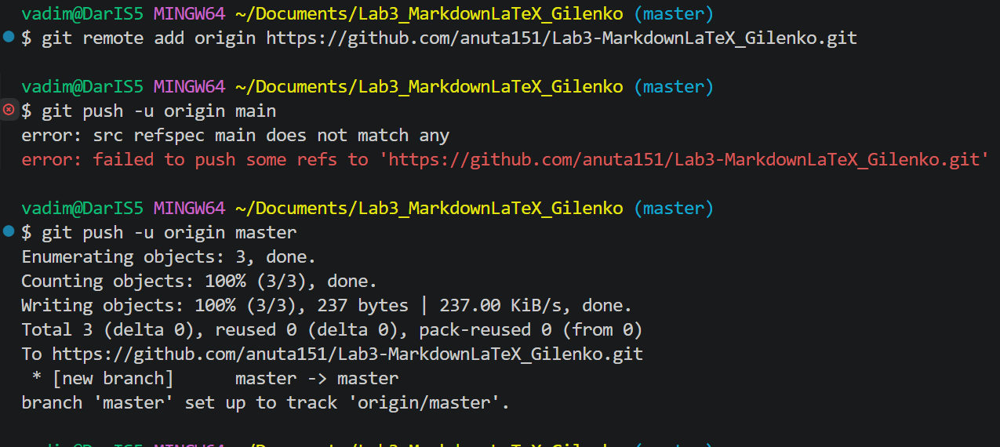

# Lab3-MarkdownLaTeX-Gilenko

Краткое описание: лабораторная работа №3 по дисциплине ИСРПО. Цель — освоить Markdown-разметку и базовое использование LaTeX в документации. В работе оформлены примеры заголовков, списков, таблиц, цитат, изображений, ссылок, чекбоксов, alert-блоков и математических формул.

## Содержание

- [Структура проекта](#структура-проекта)
- [Markdown-элементы](#markdown-элементы)
- [LaTeX](#latex)
- [Чеклист](#чеклист)
- [Ссылки](#ссылки)

---

## Структура проекта

- `docs/` — файлы с примерами Markdown
  - `headersLab3_Gilenko.md`
  - `separatorsLab3_Gilenko.md`
  - `formattingLab3_Gilenko.md`
  - `listsLab3_Gilenko.md`
  - `linksImagesLab3_Gilenko.md`
  - `codeQuotesLab3_Gilenko.md`
  - `tablesLab3_Gilenko.md`
  - `advancedMarkdownLab3_Gilenko.md`
  - `latexLab3_Gilenko.md`
- `img/` — скриншоты лабораторной работы
- `latex/` — примеры формул
- `README.md` — этот файл

## Markdown-элементы

**Полужирный**, *курсив*, ***полужирный курсив***, ~~зачёркнутый~~, `моноширный`.

### Списки

- Маркированный
- Второй пункт
  1. Вложенный нумерованный
  2. Второй вложенный

### Цитата

> Markdown — простой язык разметки.

### Блок кода

```csharp
Console.WriteLine("Hello, Markdown!");
```

### Таблица

| Элемент | Синтаксис | Пример |
|---|---|---|
| Жирный | `**текст**` | **текст** |
| Курсив | `*текст*` | *текст* |
| Код | `` `код` `` | `код` |

### Изображение



## LaTeX

Инлайн-формула: $S = \pi r^2$.

Блочная формула:

$$
\sum_{i=1}^{n} i = \frac{n(n+1)}{2}
$$

## Чеклист

- [x] Изучить заголовки
- [x] Изучить списки
- [x] Изучить таблицы
- [ ] Завершить README

## Сноска

Markdown используется повсеместно[^1].

[^1]: Сноска с пояснением.

> [!NOTE]
> Это обычная заметка.

> [!TIP]
> Полезный совет.

> [!WARNING]
> Предупреждение.

## Ссылки

- Внешняя: [GitHub](https://github.com)
- Внутренняя: [Структура проекта]
